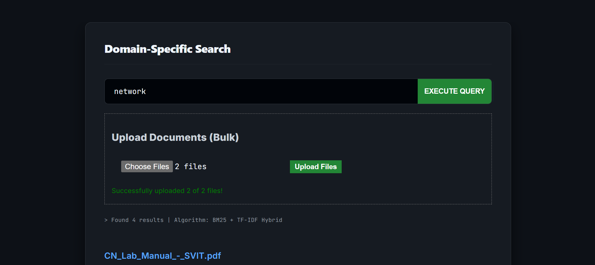
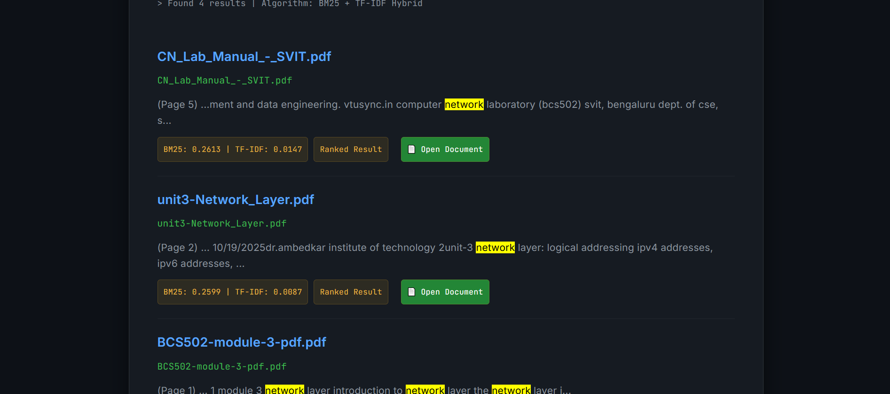
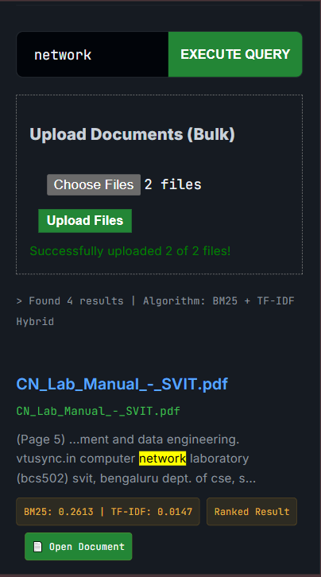

# Domain-Specific Search Engine (VTU Information Science)

A full-stack search engine for academic study material (PDF, DOCX, TXT). It builds an inverted index from uploaded documents and ranks results with **BM25**, with **TF-IDF** computed alongside as a baseline. Results show a highlighted snippet and the page number of the match, and link to the original document.

Developed for the Dr. AIT Information Science & Engineering curriculum.

**Live demo:** https://domain-specific-search-engine.onrender.com

## Screenshots






## Features
- **Ranked search:** BM25 ranking, with TF-IDF scores shown for comparison.
- **Contextual snippets:** matched words highlighted, with the page number where the match was found.
- **Open Document:** each result links to the original PDF.
- **Bulk upload:** upload several PDF / DOCX / TXT files at once. Re-uploading a file replaces its old index entries (no double counting).
- **Text cache:** extracted text is stored once at upload time, so searches do not re-parse PDFs (tens of milliseconds per query in local tests).
- **Security:** filenames sanitized with `secure_filename()` (blocks path traversal); snippets HTML-escaped before highlighting (blocks XSS).
- **Responsive UI:** works on desktop and mobile.

## How it works
1. **Upload:** text is extracted per page (PyPDF2 / python-docx), lowercased and tokenized.
2. **Index:** an inverted index maps each word to `{document: count}`; document lengths are stored for ranking. Both are saved as JSON in `data/`.
3. **Search:** for each query word, BM25 (k1 = 1.5, b = 0.75) and smoothed TF-IDF are computed per document and summed. Results are sorted by BM25.
4. **Snippet:** a window around the first match is taken from the cached text, escaped, then all query words are highlighted. The page number comes from page markers inserted during extraction.

## Tech stack
- **Frontend:** React, Vite
- **Backend:** Python, Flask, Flask-CORS, Gunicorn
- **Libraries:** PyPDF2, python-docx, PyCryptodome (encrypted PDFs), Werkzeug

## API
| Method | Endpoint | Description |
|---|---|---|
| POST | `/api/upload` | Upload one or more files (form field `file`) |
| GET | `/api/search?q=...` | Ranked results with snippet, score, and path |
| GET | `/api/files/<filename>` | Open an uploaded document |

## Local setup
1. Clone: `git clone https://github.com/kausthubh00/Domain-Specific-Search-Engine.git`
2. Backend:
```
   pip install -r requirements.txt
   python app.py
```
   Runs on port 5000.
3. Frontend:
```
   cd frontend
   npm install
   npm run dev
```
   To use a different backend URL, set `VITE_API_URL` (default `http://127.0.0.1:5000`).
4. Open the web page and upload your PDFs before searching. The `data/` folder is not stored in the repository.

## Evaluation (BM25 vs TF-IDF)
Test set: **7 indexed documents, 15 queries** (`evaluate.py`). Relevance was judged manually per query: a document counts as relevant if it covers the query topic.

| Method | Hits@1 | Recall@5 | MRR |
|---|---|---|---|
| BM25 | 93.3% | 0.816 | 0.956 |
| TF-IDF (smoothed) | 93.3% | 0.816 | 0.956 |

- **Hits@1:** share of queries where the top result is relevant (14 of 15 here).
- **Recall@5:** share of relevant documents found in the top 5.
- **MRR:** mean of 1 / rank of the first relevant result.

Run it yourself with the backend running: `python evaluate.py`

**Reading the results honestly**
- BM25 and TF-IDF performed identically on this test set. On a collection this small, both rankers pick the same top documents, so the difference between them is not visible. A larger corpus with more varied document lengths would be needed to compare them properly.
- With so few documents and several marked relevant per query, random ranking would already score roughly 50% Hits@1, so these results show the engine ranks well above chance, not that the test is hard.
- The textbook (*Data Communications and Networking*) is marked relevant for every query. Because it is large and broad, it often ranks first, so Hits@1 is optimistic. A stricter test with narrower queries and the textbook excluded is planned.

## Limitations
- Small corpus and small query set.
- Exact-word matching only (no stemming or spell correction), so "router" does not match "routers".
- The index is an in-memory JSON file, suitable for a small collection.
- No user accounts or access control.
- On Render's free tier the disk resets on redeploy, so documents must be uploaded again.

## Deployment (Render)
- **Build command:** `pip install -r requirements.txt`
- **Start command:** `gunicorn app:app`
- Set `VITE_API_URL` to the backend URL when building the frontend.
- Re-upload documents after each deploy.


## Future work
- Stemming and spell correction ("did you mean")
- Filters by subject, module, or document type
- Semantic (embedding-based) search on a hosted model
- Persistent storage for documents and the index

## Project structure
```
app.py            Flask API, indexing, ranking, snippets
evaluate.py       Evaluation script (Hits@1, Recall@5, MRR)
requirements.txt  Backend dependencies
frontend/         React + Vite web interface
```